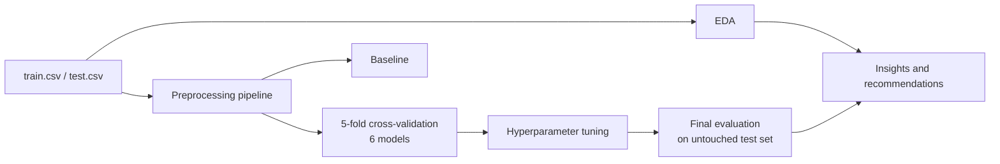

<h1 align="center">Employee Attrition Prediction</h1>
<p align="center"><b>Why do employees leave, who is likely to go, and what can a company do about it?</b></p>

<p align="center">
  
  
  
  
  
</p>

---

## Contents
1. [Aim](#-aim)
2. [Why it matters](#-why-it-matters)
3. [Dataset](#-dataset)
4. [Why employees leave and why they stay](#-why-employees-leave-and-why-they-stay)
5. [Approach](#-approach)
6. [Model results](#-model-results)
7. [What a company can do](#-what-a-company-can-do)
8. [Project files and how to run](#-project-files-and-how-to-run)
9. [Limitations](#-limitations)

---

## 🎯 Aim

1. **Understand** what separates employees who **left** from those who **stayed**, using a full exploratory data analysis.
2. **Predict** whether an employee will leave (`Attrition` = `Left`) with a tested machine learning pipeline.
3. **Recommend** where a company should look first to keep its people.

## 💼 Why it matters

Replacing an employee costs time, money and know-how. If a model can flag the groups most likely to leave, HR can act **before** the resignation instead of after it. Here, **47.5%** of the employees in the data left, so the problem is large, and the classes are balanced enough to model directly.

## 📊 Dataset

| | |
|---|---|
| Rows | 74,498 (59,598 train + 14,900 test) |
| Columns | 24 (23 features and target, plus Employee ID) |
| Missing values | 0 |
| Duplicate rows | 0 |
| Target | `Attrition`: **Left** (47.5%) or **Stayed** (52.5%) |

| Feature type | Count | Columns |
|---|---|---|
| Numerical | 7 | Age, Years at Company, Monthly Income, Number of Promotions, Distance from Home, Number of Dependents, Company Tenure |
| Ordinal | 8 | Work-Life Balance, Job Satisfaction, Performance Rating, Education Level, Job Level, Company Size, Company Reputation, Employee Recognition |
| Binary | 5 | Gender, Overtime, Remote Work, Leadership Opportunities, Innovation Opportunities |
| Nominal | 2 | Job Role, Marital Status |

## 🔍 Why employees leave and why they stay

The charts and tables show the share of employees in each group who **left** (overall: 47.5%).


### Reasons associated with leaving

| Factor | Group | Left | Compared with |
|---|---|---|---|
| Job Level | Entry level | **63%** | Senior: 20% |
| Marital Status | Single | **67%** | Married: 36% |
| Remote Work | No remote work | **53%** | Remote: 25% |
| Work-Life Balance | Poor or Fair | **60% / 58%** | Excellent: 36% |
| Promotions | 0 to 2 | **49%** | 3 to 4: 25% |
| Distance from Home | Over 50 | **53%** | Up to 50: 42% |
| Company Reputation | Poor | **56%** | Good: 43% |

### Reasons associated with staying

| Factor | Group | Left |
|---|---|---|
| Seniority | Senior job level | only **20%** |
| Flexibility | Remote work | only **25%** |
| Career growth | 3 or 4 promotions | only **25%** |
| Education | PhD | only **24%** (other degrees all about 49%) |
| Life situation | Married | **36%** |
| Wellbeing | Excellent work-life balance | **36%** |
| Dependents | 4 or more dependents | about **35%** (up to 3 dependents: about 50%) |

### What does not separate leavers from stayers
- **Monthly Income** (left: 7,275 vs stayed: 7,321, almost the same), **Job Role**, **Company Size**, **Employee Recognition** and **Leadership Opportunities** show little or no effect.
- Surprising result: employees with **Very High job satisfaction** left slightly more often (53%) than those with High or Medium (45%). The data does not explain why.
- Women left more often than men in this data (53% vs 43%). This should **not** be used for decisions about individual people; it is a reason to check for unfair treatment, not a rule.

### Statistical evidence
- **Chi-square and Cramér V** (strength of link with Attrition): Job Level 0.32, Marital Status 0.28, Remote Work 0.22, Work-Life Balance 0.20.
- **Left vs Stayed numeric means**: leavers live farther away (52.8 vs 47.4) and have fewer promotions, dependents and years at the company. The effect of each is small (Cohen d below 0.2), so no single number separates the two groups.
- **Multicollinearity**: none (every VIF is below 1.65).

> These are **associations, not proven causes.** For example, entry-level staff may leave for reasons that are not in the data.

## 🧪 Approach



| Step | What was done |
|---|---|
| 1. EDA | Information, duplicates, outliers (IQR, z-score), variance (plus Levene, Bartlett, Fligner-Killeen), skewness, kurtosis, Shapiro, D'Agostino, Q-Q plots, Yeo-Johnson, Pearson and Spearman heatmaps, correlation network, VIF, chi-square, Cramér V, Welch t-test, Mann-Whitney, ANOVA, Kruskal-Wallis |
| 2. Train and test | Test set kept untouched until the very end |
| 3. Preprocessing | One `ColumnTransformer` in the pipeline: scaling, ordered ordinal encoding, 0/1 binary, one-hot for nominal. No data leaks between cross-validation folds |
| 4. Baseline | Always predict the most common class |
| 5. Cross-validation | 5-fold stratified, 6 models: Logistic Regression, Decision Tree, KNN, Random Forest, Extra Trees, Gradient Boosting |
| 6. Tuning | `RandomizedSearchCV` (3-fold, ROC-AUC) for every model |
| 7. Evaluation | Accuracy, precision, recall, F1, ROC-AUC, confusion matrix, ROC curves, permutation importance. The best model is chosen by cross-validation score, not by test score |

## 🏆 Model results


| Model | Tuned CV ROC-AUC | Test accuracy | Precision | Recall | F1 | Test ROC-AUC |
|---|---|---|---|---|---|---|
| Baseline (most frequent) | 0.500 | 0.528 | 0.000 | 0.000 | 0.000 | 0.500 |
| Logistic Regression | 0.828 | 0.743 | 0.732 | 0.719 | 0.725 | 0.831 |
| Decision Tree | 0.818 | 0.737 | 0.722 | 0.718 | 0.720 | 0.824 |
| KNN | 0.819 | 0.733 | 0.711 | 0.732 | 0.721 | 0.820 |
| Random Forest | 0.840 | 0.756 | 0.747 | 0.729 | 0.738 | 0.845 |
| Extra Trees | 0.834 | 0.751 | 0.736 | 0.737 | 0.737 | 0.840 |
| **Gradient Boosting** | **0.850** | **0.762** | **0.747** | **0.748** | **0.748** | **0.853** |

**Winner: Gradient Boosting.** It correctly classifies about 3 in 4 employees (76.2%) and treats both classes evenly (precision and recall about 0.75 for Left and 0.77 for Stayed). Its test score is close to its cross-validation score, so it is not just memorising the training data.

**Most important features** (permutation importance): Job Level, Marital Status, Remote Work, Work-Life Balance. This agrees with the EDA.

## ✅ What a company can do

These are suggestions based on the patterns above, not guaranteed fixes.

1. **Focus on entry-level staff and new joiners.** They leave at three times the rate of seniors.
2. **Offer remote or flexible work.** Remote employees left at half the rate of on-site ones.
3. **Improve work-life balance.** Poor and Fair groups leave far more than Good and Excellent.
4. **Build a visible promotion path.** Employees with 3 or more promotions left at about half the rate.
5. **Support employees with long commutes** (over 50 distance units) with flexible hours or relocation help.
6. **Use the model as a screening tool**, not a verdict. Use it to decide where to start conversations, never to treat individuals differently.

## 📁 Project files and how to run

| File | Purpose |
|---|---|
| `employee_attrition_eda.ipynb` | Full exploratory data analysis |
| `employee_attrition_ml_pipeline.ipynb` | Full ML pipeline (preprocessing, baseline, cross-validation, 6 models, tuning, evaluation) |
| `employee_attrition_models.ipynb` | Short version: 3 models, no tuning |
| `eda_report.html` | EDA as a single report with charts |
| `images/` | Charts used in this README |
| `train.csv`, `test.csv`, `merged.csv` | Data |

```bash
pip install pandas numpy matplotlib seaborn scipy scikit-learn networkx notebook
jupyter notebook
```

Keep the CSV files in the same folder as the notebooks. The tuning cell takes about 15 minutes on one CPU core; lower `N_ITER` to speed it up.

## ⚠️ Limitations

- Findings show **association, not cause**.
- All models reach only about 76% accuracy, so the available features may be close to their limit. A wider tuning search is unlikely to help much.
- Default and tuned cross-validation scores are not exactly comparable (5 folds vs 3 folds).
- Number of Promotions has only values 0 to 4, so its z-score "outliers" are not real outliers.
- Job Role and Marital Status have no natural order, so they are tested with chi-square and one-hot encoded, not shown in the correlation heatmap.
